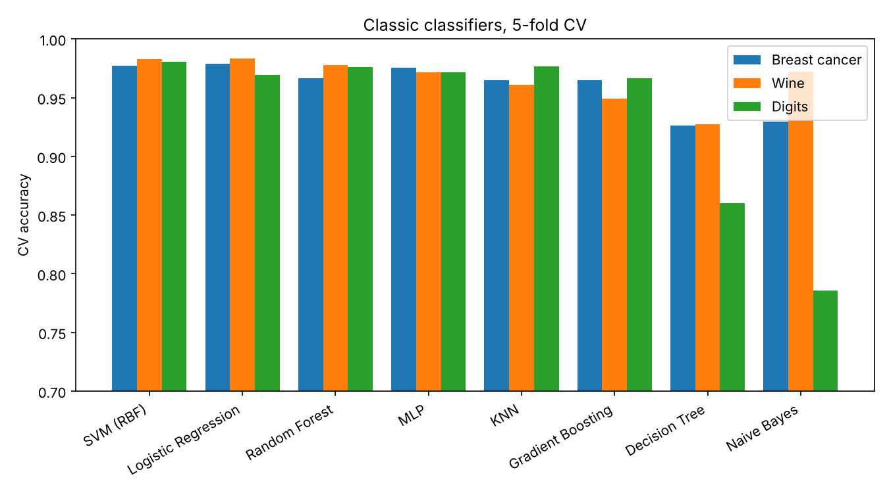

# ML

[](https://github.com/garvbehl23/ML/actions/workflows/ci.yml)

Machine learning notebooks, from-scratch NumPy implementations that are tested against scikit-learn, a reproducible benchmark, and a curated reading list.



## Contents

| Path | What it is |
|---|---|
| `Supervised_Learning/` | 10 notebooks: linear/logistic regression, KNN, Naive Bayes, SVM, trees, Random Forest, Gradient Boosting, XGBoost, MLP |
| `Unsupervised Learning/` | K-Means, DBSCAN, hierarchical clustering |
| `ML libraries.ipynb` | NumPy / SciPy / pandas / matplotlib warm-up |
| `from_scratch/` | Linear & logistic regression, KNN, Gaussian NB, K-Means (k-means++), CART decision tree, PCA, in plain NumPy |
| `tests/` | Each from-scratch model is checked against its scikit-learn equivalent |
| `benchmarks/` | 8 classifiers x 3 datasets, 5-fold CV, [results](benchmarks/results.md) |
| `docs/` | [Roadmap](docs/ROADMAP.md), [resources](docs/RESOURCES.md), [project ideas](docs/PROJECTS.md), [interview questions](docs/INTERVIEW.md) |
| `cheatsheets/` | [Algorithm picker](cheatsheets/algorithm_picker.md), [metrics](cheatsheets/metrics.md), [sklearn workflow](cheatsheets/sklearn_workflow.md) |

## Run it

```bash
git clone https://github.com/garvbehl23/ML.git && cd ML
pip install -r requirements.txt
python -m pytest -q tests            # verify the from-scratch models
python benchmarks/run_benchmark.py   # regenerate the benchmark
jupyter lab                          # open the notebooks
```

## From scratch

```python
from from_scratch import KMeans, DecisionTreeClassifier

km = KMeans(k=3).fit(X)
km.labels_, km.centers_, km.inertia_

tree = DecisionTreeClassifier(max_depth=4).fit(X_train, y_train)
tree.predict(X_test)
```

Writing these once is the fastest way to stop treating `.fit()` as magic. Each file is short enough to read in one sitting.

## Benchmark takeaways

On small, clean tabular data, a standardised SVM or plain logistic regression matches or beats the ensembles, and a single decision tree and Naive Bayes trail by several points. Gradient boosting earns its reputation on larger, messier data, which these three datasets are not. Full numbers in [`benchmarks/results.md`](benchmarks/results.md).

## Contributing

New notebooks, fixes and honest resource recommendations are welcome. See [CONTRIBUTING.md](CONTRIBUTING.md).

MIT licensed.
